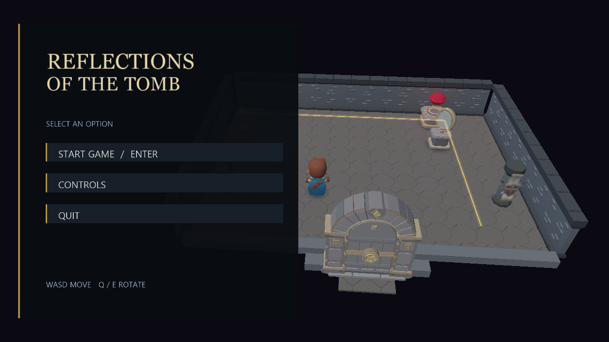
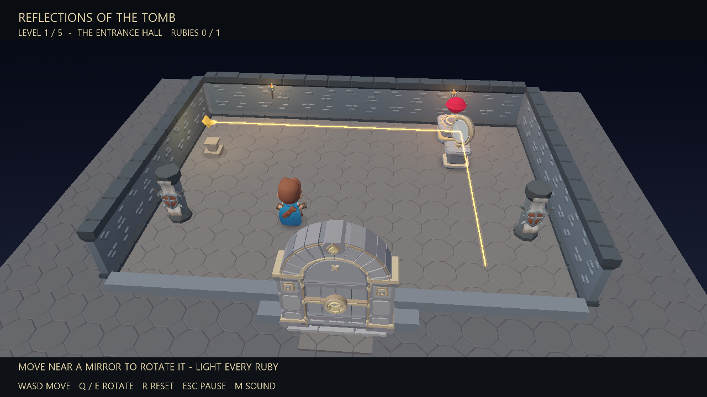
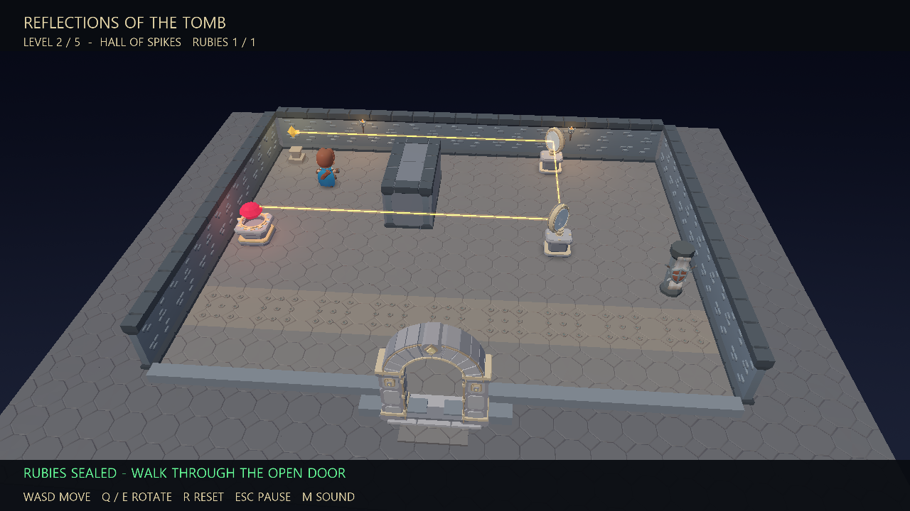
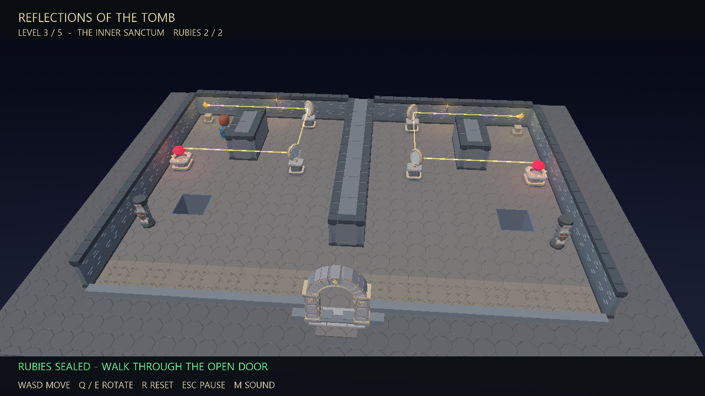
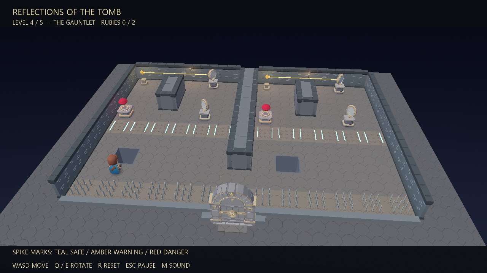
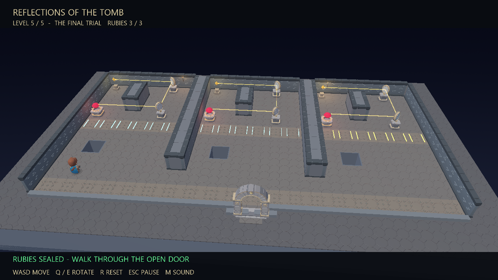

# Reflections of the Tomb

**A five-level 3D temple puzzle game built with C++17 and OpenGL 3.3.**

Guide Ranger through an ancient temple by turning mirrors, redirecting golden beams and sealing ruby objectives. Each chamber combines reflection puzzles with physical obstacles, locked doors and environmental hazards. Seal every required ruby, reach the open exit and complete all five chambers to escape the tomb.

## Screenshots

| Main menu | The Entrance Hall |
| --- | --- |
|  |  |
| **Hall of Spikes** | **The Inner Sanctum** |
|  |  |
| **The Gauntlet** | **The Final Trial** |
|  |  |

These existing campaign captures show the temple layouts and assets. The [integration record](docs/INTEGRATION_STATUS.md) describes subsequent countdown, character and trap-visibility polish and its visual checks.

## Features

- **Five playable 3D chambers** with progressive reflection puzzles, accessible mirror interactions and a complete start-to-victory campaign.
- **Continuous beam tracing:** finite mirror intersections, real-time reflections, wall obstruction and absorbing ruby targets. Required mirrors are enforced by puzzle geometry rather than rotation counters.
- **Permanent ruby sealing:** activated objectives remain sealed after moving mirrors or respawning; linked doors unlock and ruby-controlled spikes retract.
- **Timed spike sections:** independent phase offsets, safe intervals, warning cues, smooth extension/retraction and synchronized hazard collision. Pits and solid temple geometry add movement challenges.
- **Animated Ranger:** skeletal idle, walking and death clips using the supplied KayKit rig, with reliable fallbacks for incompatible animation assets.
- **Death and respawn:** a short death sequence preserves puzzle progress, followed by two seconds of visibly flickering hazard protection.
- **Campaign presentation:** large golden 3-2-1-GO countdowns, chamber title transitions, a readable HUD, start/pause/controls menus, restart/reset options and a final victory screen with the respawn count.
- **Audio:** background music, ambience, footsteps, mirror interactions, ruby sealing, doors, spike warnings/movement, defeat, respawn and interface effects.
- **Existing 3D assets:** KayKit dungeon geometry and Ranger, authored mirrors, ruby pedestals/crystals, doors, spike traps and torches, with material-aware rendering and glowing beams.

| Level | Chamber | Required mirrors | Required rubies |
| --- | --- | ---: | ---: |
| 1 | The Entrance Hall | 1 | 1 |
| 2 | Hall of Spikes | 2 | 1 |
| 3 | The Inner Sanctum | 4 | 2 |
| 4 | The Gauntlet | 4 | 2 |
| 5 | The Final Trial | 6 | 3 |

## Quick Start: portable Windows build

**Players do not need to install CMake, Python, a compiler or an IDE.**

1. Obtain the supplied Windows `presentation` folder, or ask a developer to generate it using the instructions below. Compiled game files are not included in a source checkout.
2. Copy or extract the **entire folder** to a Windows PC with an OpenGL 3.3-compatible graphics driver.
3. Double-click **`Play.cmd` inside that folder**.
4. Select **Start Game** or press **Enter**. Wait for GO, then move and interact with nearby mirrors.

Keep `assets/`, `shaders/` and the supplied runtime DLLs beside `reflections_of_the_tomb.exe`. The folder is portable as a unit; copying only the executable is insufficient.

The repository-root `Play.cmd` is a separate developer convenience launcher: it requires an existing `build-desktop` executable. For distribution, use the launcher inside the generated presentation folder.

## Controls

| Input | Action |
| --- | --- |
| **Enter** | Start the campaign from the main menu |
| **W / A / S / D** | Move Ranger |
| **Q / E** | Rotate the nearest mirror within interaction range |
| **Hold left Shift** | Fine mirror rotation |
| **Mouse wheel** | Zoom the 3D camera |
| **R** | Reset the current chamber, including objectives, mirror angles and trap phases |
| **Escape** | Pause/resume; return from the controls screen |
| **M** | Mute/unmute audio |
| **Left mouse button** | Select menu options |

Release movement/rotation keys held through the countdown before pressing them again after GO. Pause freezes countdowns, hazards, transitions, death and protection timers. Chamber reset is immediate; campaign restart begins Level 1 with its countdown and clears the respawn counter. Use the menu's **Quit** option to exit the game.

For hazard timing, mirror-angle guidance and a spoiler walkthrough, see [PLAYING.md](docs/PLAYING.md).

## Development setup

### Prerequisites

The verified Windows development environment uses:

- A **C++17 compiler** and C compiler: MSYS2 UCRT64 GCC/G++.
- **CMake 3.20 or newer** and **Ninja**.
- **Python 3 with Jinja2**, used by GLAD's code generator.
- **Git** and network access for the initial dependency fetch.
- An **OpenGL 3.3 desktop graphics driver** for running the game and graphical tests.

Run the commands below from the repository root with these tools on `PATH` (for example, from a configured MSYS2 UCRT64 toolchain environment). CMake fetches GLFW 3.4, GLM 1.0.1 and GLAD 2.0.8. The repository already supplies cgltf, stb_image and miniaudio; no separate game engine is required.

### Configure and build

```powershell
cmake -S . -B build-desktop -G Ninja -DCMAKE_BUILD_TYPE=Release -DENABLE_RENDER_SMOKE_TESTS=ON
cmake --build build-desktop --parallel 6
```

To launch the locally built game:

```powershell
.\build-desktop\reflections_of_the_tomb.exe
```

If CMake cannot find the MSYS2 tools, supply their installed paths explicitly, for example `-DCMAKE_C_COMPILER=C:/msys64/ucrt64/bin/gcc.exe`, `-DCMAKE_CXX_COMPILER=C:/msys64/ucrt64/bin/g++.exe` and `-DPython_EXECUTABLE=C:/msys64/ucrt64/bin/python.exe`.

For an already populated dependency cache, `-DFETCHCONTENT_FULLY_DISCONNECTED=ON` avoids fetching again. It is not a substitute for the initial dependency download.

### Generate the portable presentation folder

After configuring and building:

```powershell
cmake --build build-desktop --target presentation_build
```

This creates **`build-desktop/presentation/`**, containing the executable, required assets, shaders, launch script, verification documents and available local screenshot captures. The verified MSYS2 Windows build also bundles its GCC runtime DLLs. Distribute the complete folder and launch its `Play.cmd`; the recipient does not need the source tree or development tools.

### Run tests

Run the complete configured suite:

```powershell
ctest --test-dir build-desktop --output-on-failure
```

Run only graphical checks, or focus on campaign, lifecycle and puzzle validation:

```powershell
ctest --test-dir build-desktop -L render --output-on-failure
ctest --test-dir build-desktop -R "^(campaign|gameplay_flow|mandatory_reflections|timed_traps)$" --output-on-failure
```

With graphical checks enabled, the current verified Release configuration has **63 tests**, including **28 graphics-labelled checks**. Coverage includes reflection mathematics, real beam paths and mirror necessity, movement/collision, full campaign progression, timed spikes, death/respawn/protection, countdown/transition state, material rendering, animation compatibility and audio decoding. The Windows native-input replay exercises actual GLFW keyboard handling through all five chambers.

Graphical tests require a working desktop OpenGL context. Configure with `-DENABLE_RENDER_SMOKE_TESTS=OFF` when that context is unavailable; this excludes graphical checks rather than verifying them. Consult the [integration status](docs/INTEGRATION_STATUS.md) for exact verification results and limits.

## Technical architecture

The game separates rendering-independent campaign logic from platform services and presentation:

| Component | Responsibility |
| --- | --- |
| `src/main.cpp`, `src/core/` | Application entry, GLFW loop, input, screen presentation, native control replay and audio |
| `src/gameplay/` | `GameSession`, campaign/character states, ruby sealing, doors, timed/ruby-controlled traps and input gating |
| `src/world/` | Text level loading/validation, `LevelManager`, world metrics, temple geometry and static colliders |
| `src/beam/`, `src/physics/` | Continuous ray tracing, finite intersections, reflection and beam obstruction |
| `src/mirror/`, `src/player/` | Mirror transformations and proximity interaction; Ranger movement and wall collision |
| `src/rendering/`, `shaders/` | Model/material loading, CPU skeletal skinning, OpenGL rendering, lighting, UI and effects |

### Graphics and geometry

- **Reflection:** outgoing direction follows `R = D - 2 * dot(D, N) * N`, where `N` is the unit mirror normal. Continuous rays intersect finite mirror segments and wall boundaries, then test ruby targets. Puzzle optics occupy the X/Z plane at a shared beam height inside the rendered 3D world.
- **Transforms and asset rendering:** composed glTF node transforms, inverse-transpose normal transforms, texture/material factors and alpha handling keep imported assets aligned with world-space gameplay.
- **Animation:** compatible clips are retargeted by joint name, sampled with keyframe interpolation and applied through CPU skinning. Death playback clamps to its terminal pose; instance opacity provides protection flicker.
- **Lighting and effects:** GLSL material shading combines ambient/directional and local lights, emissive ruby effects, depth-tested golden beams, contact shadows and distance haze against a navy background.
- **Collision and hazards:** player movement resolves against temple colliders; spike hazards use the player footprint and visible extension state. Simulation delta time drives independent spike phases and gameplay/presentation timers.
- **Verification:** continuous-angle conservative visibility analysis and real BeamTracer angle searches test mandatory reflection dependencies, including alternate paths and permanent-sealing sequences. See [PUZZLE_VERIFICATION.md](docs/PUZZLE_VERIFICATION.md).

The preserved `experiments/software_raster_demo/` implements Bresenham lines, polygon representation, even-odd scanline filling, translation and boundary clipping as a separate educational software-rasterization demonstration. It is tested alongside the project; the playable campaign uses the OpenGL 3D renderer.

## Team

The integration preserves the team's original contributions and contributor attribution.

| Team member | Responsibility |
| --- | --- |
| **Peter Nyamu** | Beam tracing, ray casting, light reflection, mirror/beam collision physics |
| **Joe Ndeto** | 3D rendering, temple presentation, lighting, shaders and asset integration |
| **Jesse Mbugua** | Ruby activation, doors, traps and puzzle mechanics |
| **Joy Senetwo** | Mirror transformations and rotation |
| **Kimberly Wangari** | Player movement, interactions and character assets |
| **Zahra Isaiho** | Data-driven levels, level management, temple geometry and collision information |

The game also uses supplied KayKit and other repository assets. See the included [asset licences](assets/licences/) and [audio attribution notes](docs/THIRD_PARTY_AUDIO.md); imported art and audio are distinct from the team's programming contributions.

## Repository structure

```text
reflections_of_the_tomb/
|-- src/
|   |-- main.cpp
|   |-- core/
|   |-- gameplay/
|   |-- world/
|   |-- beam/
|   |-- physics/
|   |-- mirror/
|   |-- player/
|   |-- rendering/
|   `-- third_party/
|-- assets/
|   |-- levels/          # Five authored chamber definitions
|   |-- models/
|   |-- animations/
|   |-- audio/
|   |-- textures/
|   |-- ui/
|   |-- vendor/
|   `-- licences/
|-- shaders/
|-- tests/
|-- demos/               # Level preview/export tools and team demos
|-- experiments/         # Standalone graphics demonstrations
|-- tools/               # Capture, campaign repetition and debugging helpers
|-- cmake/               # Presentation packaging script
|-- docs/
|   `-- screenshots/     # Committed campaign gallery
|-- CMakeLists.txt
|-- Play.cmd             # Developer launcher; requires build-desktop
`-- README.md
```

`build-desktop/` and other local build outputs are generated artifacts, not part of the source distribution.

## Documentation and remaining limitations

- [Playing guide and presentation walkthrough](docs/PLAYING.md)
- [Integration decisions, visual checks and verification results](docs/INTEGRATION_STATUS.md)
- [Puzzle solutions and reflection-dependency verification](docs/PUZZLE_VERIFICATION.md)

The five-level campaign, animation, audio, menus, hazards and victory progression are implemented. Remaining limits concern portability and verification: the presentation package is verified on the local Windows/OpenGL environment, not across all GPUs, operating systems or keyboard layouts. CPU animation uses a static/procedural fallback if supplied clips are incompatible; audio falls back to silence if no output device is available. Automated playback checks do not establish physical speaker audibility or performance on other hardware.
